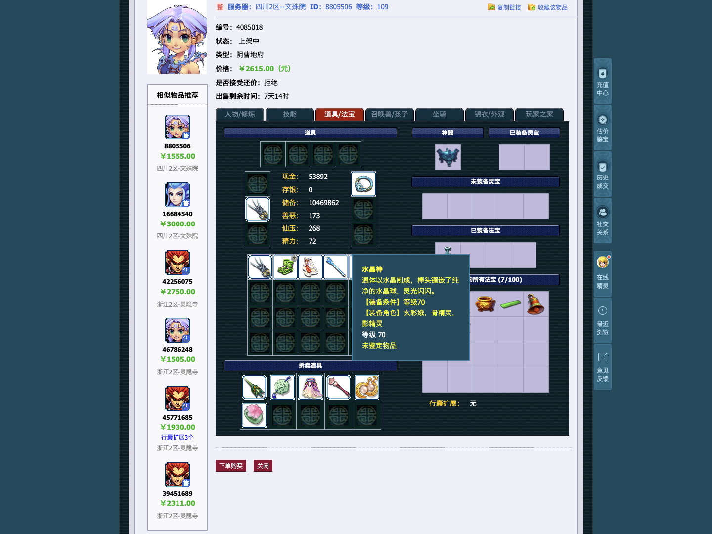
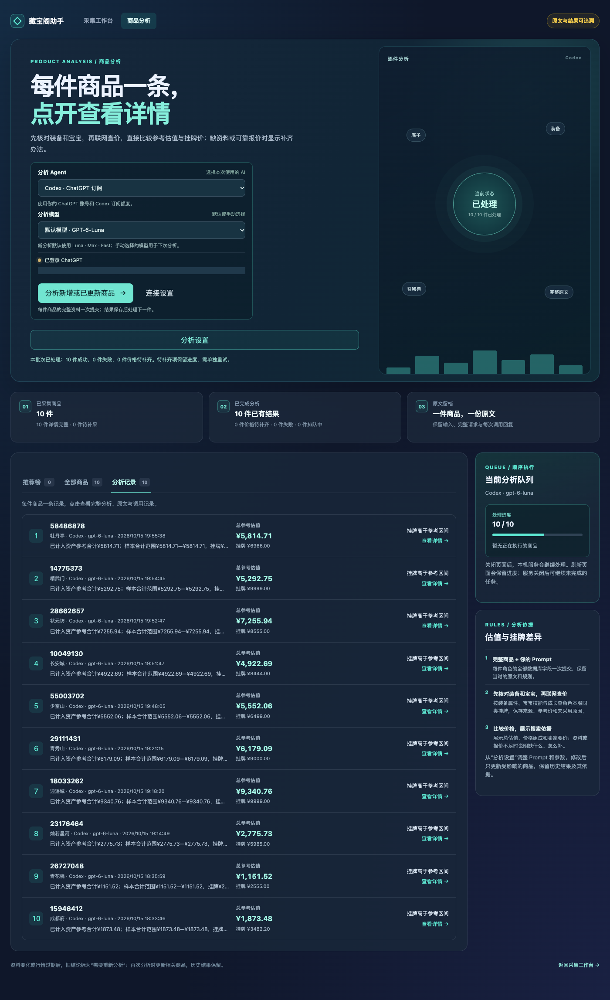

# 真实角色采集与报价 E2E

本案例连接真实藏宝阁和本机 Codex，按官网当前列表顺序选取挂牌价不低于3000元的 2 个不同角色；3000元门槛仅用于此真实测试，不加入正式项目的采集或分析规则。每次新运行创建独立 SQLite 和 Prompt 副本，并调用生产清空接口，保存采集记录和分析批次均为零的证据；不启用定时采集。人工等待后的续跑保留当前两角色的断点，不再次清空。

实现前确认的失败情况：

- Chrome 未开启远程调试，或连接授权未完成。
- 未登录、二维码过期、手机确认未完成、网站要求验证码或限制访问。
- 官网列表不足 2 个挂牌价不低于3000元的角色，列表变化，商品下架。
- 任一角色标签、装备或宝宝资料不完整，补采失败。
- Codex 未登录、连接验证失败、额度不足、请求失败。
- 同一已登录账号的一次验证失败被缓存，后续重试直接返回旧错误；读取账号本身失败时仍需停止请求。
- 连接测试已收到完整回复却等待 SDK 退出；仅收到文本、缺少完成事件、失败或取消均不能算验证成功。
- 报价搜索未结束、没有可靠样本、价格或商品身份不匹配。
- 分析返回缺项、金额不能复算、结果刷新后丢失。

## 运行

先在日常 Chrome 的 `chrome://inspect/#remote-debugging` 开启远程调试。测试用隔离 Chrome 展示本地助手，实际采集仍连接日常 Chrome。Codex 中启动测试时，必须按 AGENTS.md 申请沙箱外执行。

```bash
CBG_LIVE_E2E=1 vp run test:e2e:live
```

默认地址为 `http://127.0.0.1:5187`，端口占用时直接失败，不复用其他服务。只有显式设置 `CBG_LIVE_E2E=1` 才执行真实请求；普通 `test:e2e` 不会运行此案例。

流程：启动真实本地服务 → 清空采集与分析数据并核验为零 → 点击查询角色 → 扫码/确认 → 核对三年以上服 → 按列表顺序读取并悬停前 2 个挂牌价不低于3000元的商品 → 登记这 2 条真实列表记录 → 用现有补采接口获取详情 → 核对完整性 → 验证 Codex → 在页面开始分析 → 装备、宝宝及宝宝装备逐项查价（装备、灵饰、宝宝和宝宝装备均为每条件前5条候选；有效样本取最低价，无样本跳过） → Codex 分析 → 刷新页面并核对保存结果。

登记列表记录使用生产 `CrawlStore.observe`，内容来自实时官网页面；这是为了限制采集范围，不注入详情、价格样本或 AI 回复。查询、补采和分析均调用生产接口，页面和网络请求不做模拟。

每次连接先核验官方跨服页面的服务端登录状态；有效时直接复用，不重新进入默认服务器要求扫码。只有服务端未确认登录时才进入登录流程。已采齐两角色的续跑直接使用本地资料，不重新查询列表。

需要人工操作时，控制台输出 `CBG_LIVE_ATTENTION`，运行目录生成 `attention.json`。扫码在本地助手页面完成；安全验证需要打开当前受阻的工作页。操作完成并同意继续后执行：

```bash
node scripts/live-e2e-continue.mjs data/live-valuation-e2e/run-实际目录
```

该命令只确认当前等待点。测试会重新检查真实状态；不会因写入确认就把登录、采集或报价视为成功。等待期间没有总测试超时；正常阶段超时会转为人工等待或失败。人工等待不会自动点击网站验证。

停止旧测试后，可以续跑同一组 2 个角色，保留已采集资料、报价断点和冻结的 Prompt：

```bash
CBG_LIVE_E2E=1 CBG_LIVE_RUN_DIR=data/live-valuation-e2e/run-实际目录 vp run test:e2e:live
```

续跑只接受本项目的测试运行目录，并核对库中正好是已选的 2 个角色。已有批次继续监控或恢复，避免重复创建批次。普通页面等待最多 30 秒，人工确认等待仍保持开放。

## 结果

分析不再执行相似整号市场查询或生成整号参考价；专用/绑定装备、官网检索不支持的等级装备，以及官网确认但无独立交易筛选定义的特殊宝宝按用户规则跳过，不查询、不计价，保留市场售价未知并列明排除原因。旧规则的暂停批次需要按新规则重新分析，采集资料和历史结果保留。

运行目录保存 `reset.json` 清空证据、`manifest.json`、`progress.json`、2 份采集资料、2 份分析及报价证据、最终截图和 SHA-256。测试成功必须满足：2 个角色详情完整、2 次真实分析完成、官网查价证据存在、每个角色有可核对的价格结果、页面刷新后仍有 2 份结果。

查价或分析错误转入 `repair` 等待，服务和逐件断点保留，修复后续跑；未取得两个最终报价不算通过。异常退出时保存为 `incomplete`，不报告流程通过。可以从保留的测试库检查具体问题。扫码内容、Cookie、账号和整个浏览器网络流量不作为测试产物保存；只保留本次商品资料和报价证据。

## 默认分析模型

本项目新分析默认选用 `gpt-6-luna`，通过 SDK 设置 `modelReasoningEffort: "max"` 和 `service_tier: "fast"`。模型必须在当前账号的官方列表中；不可用时说明原因，不静默换模型。连接验证保持低推理强度。用户仍可明确选择其他模型，已保存批次继续沿用其冻结模型；不修改用户全局 Codex 配置。

配置依据：[官方模型说明](https://learn.chatgpt.com/docs/models)、[官方配置说明](https://learn.chatgpt.com/docs/config-file/config-reference)。fast 的实际处理速度由服务端决定。

## 10角色边采集边分析

新案例按官网当前列表顺序取10个不同角色，不设3000元门槛，不替换失败角色。第1个采齐后马上启动默认 Luna · Max · Fast 分析，同时继续逐个采集第2～10个。采集成功事件自动追加到当前普通分析批次，使用该批次冻结的模型和Prompt；指定商品试分析不会扩大范围。队列暂空且采集仍进行时继续等待，暂停可打断等待，续跑会补入暂停期间新采齐的角色。

隔离验证前列出的失败情况：清空或续跑错误；跨页漏项或重复；等全部采齐才分析；没有真实采集/分析重叠；后续入队遗漏或重复；未完整资料提前入队；试分析范围扩大；冻结配置改变；工作页互相干扰；重复扫码或绕过验证；并发确认互相覆盖；出现失败仍继续处理后续角色、未修复就续跑；不足十份报价却通过；刷新丢失结果；把未知价格当零。

```bash
CBG_LIVE_E2E=1 vp exec playwright test tests/live/streaming-valuation.live.ts --config playwright.live.config.ts
```

续跑时加上同一运行目录：

```bash
CBG_LIVE_E2E=1 CBG_LIVE_RUN_DIR=data/live-valuation-e2e/run-实际目录 vp exec playwright test tests/live/streaming-valuation.live.ts --config playwright.live.config.ts
```

需人工扫码或决策时仍使用 `scripts/live-e2e-continue.mjs` 确认当前等待点。不同流程的确认串行等待，避免覆盖。证据包括 `timeline.json`、官网列表顺序、清空证明、10份采集详情、10份分析、`quotations.json`、`pricing-policy-proof.json`、最终截图与哈希。时间线必须证明第1个采齐后开始分析，第2个采集时该分析批次仍在运行；最终同一批次有10份真实报价，失败与待补齐均为0，并通过页面刷新检查。计价核验产物逐项保存目标区服、实际请求范围、合格样本、最低价和跳过状态。

批次会保存启动时的全服区服行情，后续采齐的角色按其区服匹配这份冻结行情；现金、存银和储备金仍按对应金价换算，手动参数优先，缺失区服不会借用别服金价。装备、灵饰、宝宝和宝宝装备均只查询角色所在服务器；实际请求和候选链接都必须与该服务器一致，缺失或错服会暂停，不回退全服。官网公示期宝宝使用 `pet_attr_panel`、`pet_desc` 和主商品名称绑定读取，仍核对原始属性、在售状态、价格单位与随身装备，排除推荐和附加费用。若分析完成但仍缺完整报价，真实 E2E 保留批次并等待修复，不提前结束。

发现失败或待重试的查价项时，这个真实案例会立即暂停采集和分析，记录 `failure_stop`，修复确认后记录 `repair_resume` 并续跑。单角色每次连续执行最多45分钟、16轮，装备和宝宝阶段结束后先核对预算，再进入下一查询阶段；人工修复后显式续跑重新获得这份预算。单次查询超时和无进展停止规则保留。状态列表在SQL读取阶段裁掉候选和查询大字段，再返回原有报价摘要；完整证据通过详情读取，保存内容和金额不变。

服务本身在查价读取失败或无进展后保存断点并暂停批次，不再领取下一角色；AI 输出校验失败也立即保存回复并暂停。普通“继续分析”不能越过失败或待补齐项，处理原因后使用“重试失败及待补齐”按原顺序恢复。正常多轮查价仍继续推进，无样本和规则跳过仍不计价。独立管线审查与可选优化见 [采集与分析审查报告](capture-analysis-optimization-review.md)。

10角色案例续跑会先建立日常Chrome工作连接并核验有效登录；已采齐的角色直接使用保存资料，不重新选样或清空。如果测试用的隔离Chrome被关闭，重启同一目录的测试工作进程后续跑。

跟随采集的批次暂停后，即使现有任务全完成、后续角色还没采齐，也能恢复。采集仍在运行时等待新资料；当前没有采集活动时正常结束本轮，下一角色采齐后继续追加原批次。已完成角色不重新分析，失败和待补价仍须显式重试。

人物装备、灵饰及宝宝的每个筛选条件只核验官网顺序中的前5条不同候选；不足5条时使用实际结果。有效报价取最低价，宝宝的同配和相近样本分别计价；宝宝装备也仅核验每条件前5条不同候选，拒项占名额，只用于宝宝包价核对，不重复加总。各计价条件都无有效样本时跳过并注明搜索范围有限，不表示全市场无匹配；普通装备和灵饰单件查询或读取第1次失败会重试一次，第2次失败跳过并保留原因和未知价格；登录、验证、权限或错服仍暂停处理。其他资产的读取错误仍先修复。所属宝宝已跳过时，其随身装备也跳过并保留原因和未知价格。

人物装备先扣除可核验的宝石加成，按同等级、同类型及实际显示的完整套装效果、特技、特效搜索，同种类允许不同名称或型号，但必须有官网类型证据，套装效果、特技、特效（包括无）均须一致，不能替代；在前5条详情中核验各基础值≤目标；官网基础属性控件仅支持≥，因此不填数值下限，不额外筛宝石段数、修理或开孔。相等与较低基础值的合格样本共同取最低价，保留各项差异；熔炼保持独立，不重复扣除。按部位要求核心初始值：武器初伤、衣服和头部初防、腰带初血、鞋子初敏、项链初灵。缺宝石段数、未知宝石或混合加成导致核心值无法可靠还原时，直接跳过、不计价并保留未知；辅助属性不能替代核心值。采集不完整仍保留读取失败，不伪装为规则跳过。完整原文上限为256 KiB，超限时保存原文但不截断发送。

宝宝候选的官网未命名饰品若只显示“玄天灵力”，无法核验包价，则排除此候选并保留原因，仍占该条件前5条名额。同一次查价缓存这类已确定的排除结果，避免不同条件重复打开同一详情；缓存随查询页面关闭而释放。登录、网络及普通读取失败不缓存，仍保留重试。

本次续跑保留批次冻结的原始模板和配置哈希；实际AI请求中附加的程序化查价规则明确取代模板中的旧样本口径，所有资产均只核验每条件前5条不同候选。模板文件供新批次使用，并非续跑时覆盖原模板。

计价策略变化时旧报告保留。本轮独立真实测试不重复分析旧角色，通过 `CBG_LIVE_EXCLUDE_KEYS_FILE` 指定已分析角色键的JSON数组，按官网顺序跳过这些角色；新目录启动会清空自身测试数据，续跑保留当前目录和排除清单。

续跑检查汇总及已核验候选各自的24小时有效期；较新的汇总时间不能让旧样本继续计价。过期样本所在项重新查价，其余有效项和原查询历史保留；未核验的候选不触发额外重查。长时间人工等待后，最终验收可能需要重新核验过期阶段，不能只改时间戳或沿用过期价格。

## 运行中核对搜索页面

十角色测试会通过同一生产 Playwright 连接读取本次创建的官网工作页，保存稳定截图（搜索表单整页、详情页当前视口）、原始控件值、公开提交参数、主商品身份和可见内容。截图前后状态变化时丢弃画面并记录原因，不滚动、悬停或改变查询；登录和验证画面不保存。证据位于运行目录的 `work-page-evidence/session-*/index.json`，每张图片和JSON均有SHA-256，最终manifest索引清单。

每个角色已有最终数值参考且缺项为0时，隔离测试页面会立即打开该任务的真实详情，核对任务ID和商品键，并保存 `analysis-review-N.png/json`。截图用于查看报价呈现，JSON保留当时渲染文字及数值；完整AI输入和回复仍以任务调用记录为准。

截图审查必须按商品身份和实际条件对应原始资料、查价记录及AI输入，不能只按时间猜测。短暂页面可能漏取，详情页视口外内容不在截图中；完整HTTP筛选参数未被独立记录。已有网络证据用于核对实际区服及页码，公开提交参数用于核对表单，缺失覆盖应列明。失败情况见[工作页截图说明](live-work-page-evidence-failure-cases.md)。

官网明确显示“未鉴定物品”的装备，在提示框名称和等级与目标绑定正确时视为资料完整，保留该状态；不等待本就不存在的伤害、命中等数值。未鉴定装备仍按核心初始值未知跳过计价，名称或等级冲突、普通已鉴定装备缺属性继续按采集失败处理。官网未提供分类的未鉴定装备也须进入装备清单并明确跳过，不能遗漏该项目而留下不完整合计；不会根据名称猜测装备类型。

下面是本轮真实工作页截图：8805506的水晶棒提示框已显示等级70及“未鉴定物品”。这是采集原文证据，未鉴定状态不提供可用的初始伤害，不能据此计价。



列表初筛与详情核验都接受候选已可靠扣成0的黑宝石速度；候选列表省略字段时不推断0，仍等待完整详情。正初速、未知或混合宝石继续遵守原有完整核验规则。

## 2026-10-15 真实十角色验收结果

批次 `run-UL6ZFv` 于北京时间19:55:42完成：10个新角色均有数值参考合计，失败0、待补价0、复用旧角色0，页面刷新通过。首个角色采齐后3.278秒启动分析，第二个角色采集时分析已在运行；后续采齐角色自动加入同一队列。官网、采集、行情和Codex回复均为真实数据。

运行始于 `c120b46`，先后应用 `a5080f6`、`db283cf`、`6c7e54b` 修复；原始manifest与独立修复历史保留阶段边界。按用户要求，第4个角色55003702和第7至10个角色采用严格实际套装规则，其他5份已完成报价保留，内容哈希未变；不能称全部10份都按最后一版规则重算。

| 角色     | 区服     |   挂牌价 | 参考合计 |
| -------- | -------- | -------: | -------: |
| 15946412 | 成都府   | ¥3482.20 | ¥1873.48 |
| 26727048 | 青花瓷   | ¥2555.00 | ¥1151.52 |
| 23176464 | 灿若星河 | ¥5985.00 | ¥2775.73 |
| 55003702 | 少室山   | ¥6499.00 | ¥5552.06 |
| 18033262 | 逍遥城   | ¥9999.00 | ¥9340.76 |
| 29111431 | 青秀山   | ¥9000.00 | ¥6179.09 |
| 10049130 | 长安城   | ¥8444.00 | ¥4922.69 |
| 28662657 | 状元坊   | ¥8555.00 | ¥7255.94 |
| 14775373 | 精武门   | ¥9999.00 | ¥5292.75 |
| 58486878 | 牡丹亭   | ¥6966.00 | ¥5814.71 |

55003702的实际附加状态变身套装查询含官网 `suit_effect=4011`：黑魔冠66元、同类型腰带77元、鞋子44元，合计187元；该角色参考合计5552.06元。旧的鬼将套装样本已移除。参考合计不含规则跳过或前5条无合格样本的资产，其市场价格仍未知。

独立核验确认34份manifest索引文件哈希、官网选择顺序、旧批次完整内容哈希、保留的5份任务、实际AI请求哈希及本服查询范围。对采用新套装规则的5个角色额外核对22条有效装备样本的套装/特技/特效一致、基础值上限及实际套装提交参数。原始数据保存在运行目录，未将账号数据或完整原文提交仓库。


